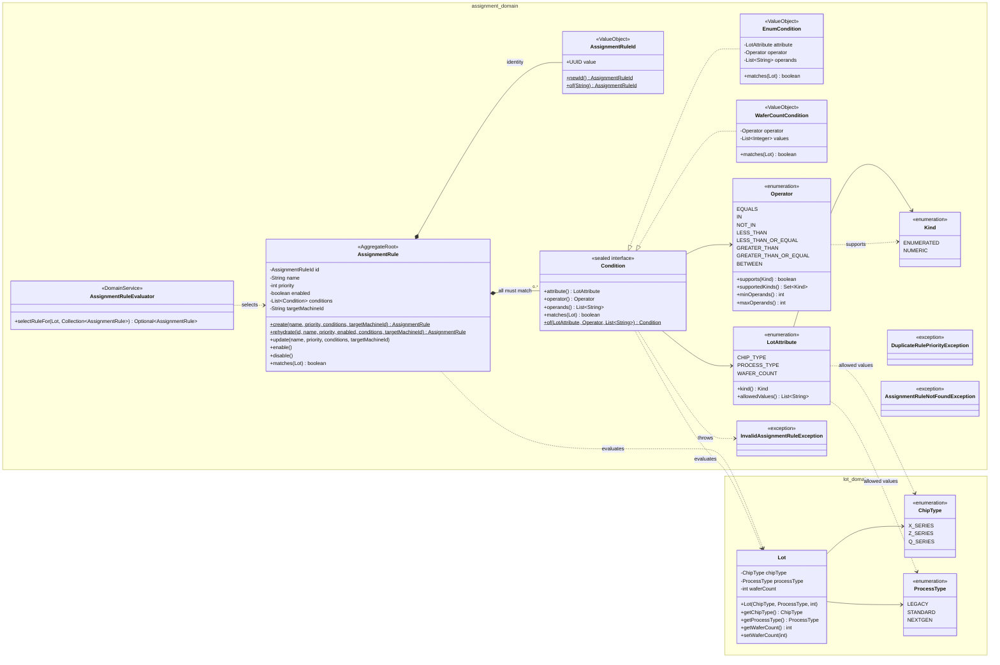
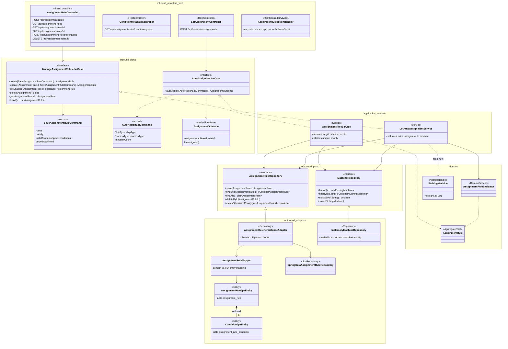
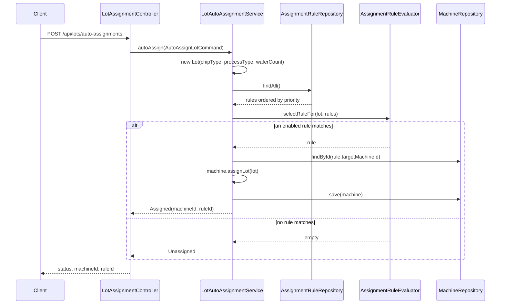

# Rules Engine – Class Diagrams

The lot assignment rules engine follows a hexagonal (ports and adapters) layout:

- **`domain`**: plain Java, with no framework code.
- **`application`**: use cases (inbound ports), repository interfaces (outbound ports) and the services that implement the use cases.
- **`adapter`**: the REST, persistence and configuration code that plugs into those ports.

Source root: `src/main/java/com/orthanc/orthanc_prototype/`.

## 1. Domain model

An `AssignmentRule` routes a `Lot` to a target machine when **all** of its conditions match. `AssignmentRuleEvaluator` picks the enabled rule with the lowest priority that matches.

### Operator support

| Operator | Chip type / process type (`ENUMERATED`) | Wafer count (`NUMERIC`) | Operands |
|---|:-:|:-:|---|
| `EQUALS` | ✓ | ✓ | 1 |
| `IN` / `NOT_IN` | ✓ | ✓ | 1 or more |
| `LESS_THAN`, `LESS_THAN_OR_EQUAL`, `GREATER_THAN`, `GREATER_THAN_OR_EQUAL` | | ✓ | 1 |
| `BETWEEN` (inclusive) | | ✓ | 2 (min ≤ max) |

## 2. Hexagonal architecture: ports and adapters

### Dependency rules

`HexagonalArchitectureTest` enforces these with ArchUnit:

- `..domain..` must not depend on Spring, Jakarta, Hibernate, Jackson, `..application..` or `..adapter..`.
- `..application..` must not depend on `..adapter..`.

## 3. Auto-assignment flow

